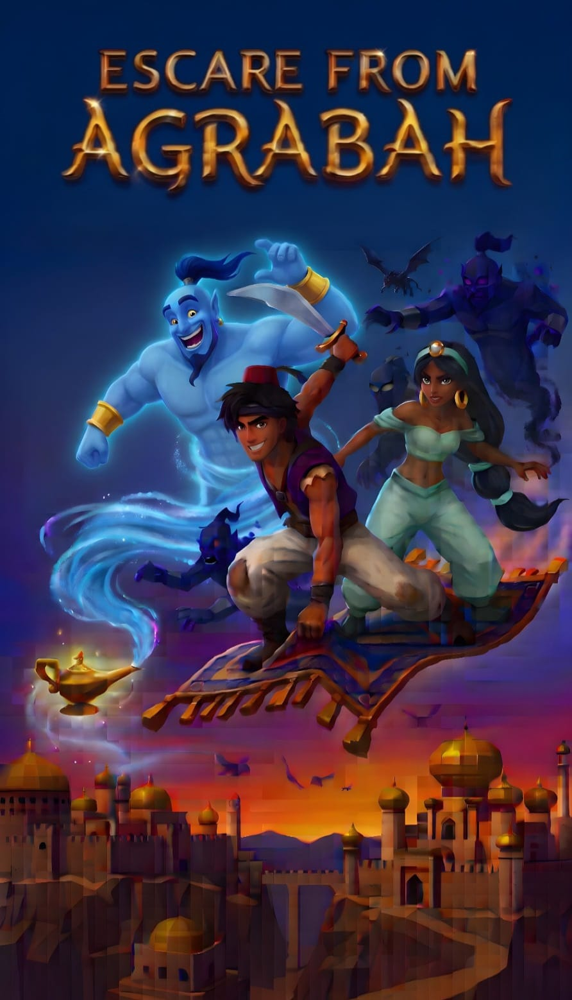

# Aladdin: Escape from Agrabah

## 📜 The Story

After a daring heist to steal the magic lamp, Aladdin escapes into the night sky on a flying Carpet. He is joined by the powerful Genie, who grants him three wishes and lends his magical aid for the dangerous road ahead. Hunted through the clouds by evil spirits and thieves, Aladdin channels the Genie's magic to strike down his pursuers and clear a path to the royal palace.

Upon landing, the magical aerial chase gives way to a clash of steel. Aladdin draws his sword to face a deadly blockade of corrupt guards and mercenaries holding the palace grounds. He battles his way through the winding corridors, fighting off enemies at every turn until he reaches the high tower. 

There, he finds Princess Jasmine. After defeating her remaining enemies, they rush to the edge of the balcony, leap onto the Magic Carpet, and vanish into the starlit sky to escape Agrabah forever.

## 🎮 Controls

* **W:** Move Carpet Up
* **S:** Move Carpet Down
* **SPACEBAR:** Throw Magic Lamp
* **R:** Restart (After Victory)
* **ESC:** Quit Game
